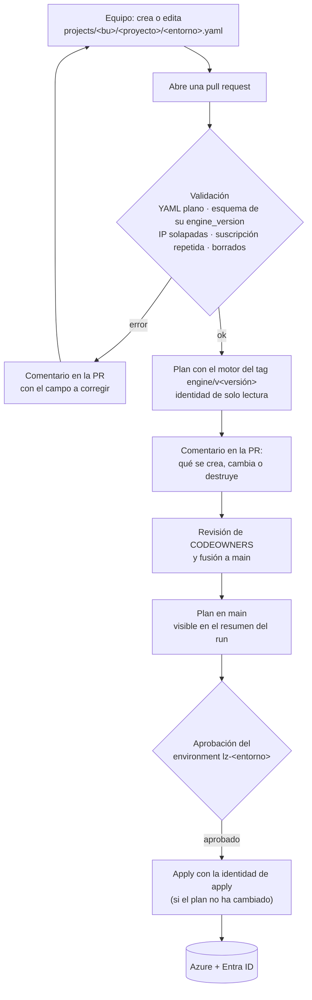

# Motor de Landing Zones

Cada equipo describe su proyecto de Azure en **un fichero YAML por entorno**. Un motor Terraform versionado lo convierte en infraestructura: resource group, grupos de Entra ID con sus roles, red conectada al hub y monitorización central.

No hace falta saber Terraform ni tener credenciales de Azure. El único camino es **YAML → pull request → revisión → despliegue**, y el pipeline se autentica por OIDC, sin secretos.

## Cómo funciona



- **Datos y motor separados.** `projects/` solo contiene YAML y `engine/` solo contiene código. Ningún proyecto copia ni genera código.
- **Un state por proyecto y entorno.** Un error en un proyecto no afecta a los demás ([ADR-0002](docs/adr/0002-deployment-unit.md)).
- **Versiones explícitas.** Cada YAML fija `engine_version`, y una versión nueva del motor solo llega a un proyecto cuando su YAML la pide ([ADR-0003](docs/adr/0003-engine-versioning.md)).
- **Errores antes del plan y en términos del YAML.** El esquema JSON se comprueba en segundos y las reglas que el esquema no puede expresar las comprueba Terraform ([ADR-0004](docs/adr/0004-two-layer-validation.md)).
- **Sin escalado de privilegios.** Las identidades del pipeline solo pueden asignar los roles del catálogo, y solo a grupos ([ADR-0005](docs/adr/0005-identities-and-permissions.md)).

## Quickstart: dar de alta un proyecto

Pide al equipo de plataforma el código de tu unidad de negocio, una suscripción y un rango de IP (si necesitas red). Después:

```bash
git switch -c alta-pga-billing-dev
mkdir -p projects/pga/billing
cp engine/examples/projects/demo/webapp/pro.yaml projects/pga/billing/dev.yaml
# Edita: business_unit, project, environment, subscription_id, tags, access y network
pre-commit run --files projects/pga/billing/dev.yaml   # opcional: valida en local
git add projects/pga/billing/dev.yaml && git commit -m "Alta de pga/billing/dev"
git push -u origin alta-pga-billing-dev                  # y abre la pull request
```

El fichero mínimo válido es este:

```yaml
engine_version: "1.0.0"
business_unit: pga
project: billing
environment: dev
subscription_id: "00000000-0000-0000-0000-000000000000"
location: westeurope
tags:
  cost_center: "ES0009"
  business_owner: owner@example.com
  technical_owner: billing-team@example.com
```

El paso a paso completo, con los errores habituales, está en la [guía de alta de proyectos](docs/guia-alta-proyecto.md). Cada campo está descrito en la [referencia del YAML](docs/referencia-yaml.md).

## Documentación

| Para | Documento |
|---|---|
| Equipos que dan de alta o cambian un proyecto | [Guía de alta de proyectos](docs/guia-alta-proyecto.md) |
| Consultar un campo del YAML | [Referencia del YAML](docs/referencia-yaml.md) |
| Cambiar el motor y publicar versiones | [Contribuir al motor](docs/contribuir-motor.md) |
| Poner en marcha la plataforma (una vez) | [bootstrap/README.md](bootstrap/README.md) |
| Entender las decisiones | [ADRs](docs/adr/) y [roadmap](docs/roadmap.md) |
| Ver los cambios de cada versión | [engine/CHANGELOG.md](engine/CHANGELOG.md) |

## Estructura del repositorio

| Carpeta | Contenido |
|---|---|
| [`projects/`](projects/) | Datos: `<bu>/<proyecto>/<entorno>.yaml` y `_platform/platform.yaml` (hubs y Log Analytics, del equipo de plataforma) |
| [`engine/`](engine/) | Motor: [catálogo](engine/catalog/catalog.yaml), [esquemas JSON](engine/schema/), [módulos](engine/modules/), [root module](engine/root/) y [ejemplos](engine/examples/). Versionado con tags `engine/vX.Y.Z` |
| [`bootstrap/`](bootstrap/) | State de Terraform (solo Entra ID) e identidades OIDC del pipeline |
| [`.github/workflows/`](.github/workflows/) | `projects-pr`, `projects-apply`, `engine-pr` y `engine-release` |
| [`scripts/`](scripts/) | Validaciones, tests y scripts del pipeline (`scripts/ci/`) |
| [`docs/`](docs/) | Guías, referencia, ADRs y roadmap |

## Desarrollo local

Requisitos: Terraform 1.17.1, tflint 0.65.0, terraform-docs 0.24.0, checkov 3.4.3, Python 3.11+ y pre-commit 4.

```bash
pre-commit install
pre-commit run --all-files   # formato, lint, seguridad, esquemas, YAML plano y terraform test
scripts/plan-examples.sh     # plan simulado de todos los ejemplos
```

Nada de esto toca Azure: los tests usan providers simulados. Solo el pipeline despliega. La única excepción es el bootstrap inicial, que se ejecuta a mano una vez ([bootstrap/README.md](bootstrap/README.md)).
